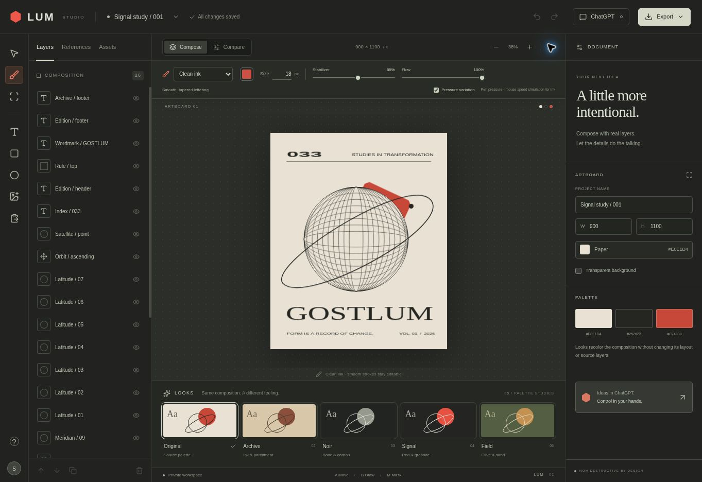

# LUM

A private layered design studio for Stefan. The red hexagon is the identity; ChatGPT is the instruction surface, and the browser editor is the visual work surface.

This is an editable composition tool. Projects contain separate text, shapes, paths, images, transforms, masks and references. They are not flattened into a single generated image when saved.



## What works

- Select, move, resize and rotate individual objects with Fabric.js controls.
- Native text, rectangles, ellipses, editable brush paths and uploaded artwork.
- Paste copied images with Ctrl+V / ⌘V or the Paste image button. Each image becomes its own layer, preserving supplied transparency.
- Four stabilized brushes: Clean ink, Round marker, Chisel marker and Dry spray. Adjust size, color, stabilization, opacity, pressure variation and chisel angle.
- Layer visibility, opacity, locks, duplication, deletion and stack order.
- Reversible rectangular and elliptical masks.
- Reference images with structure, style, palette, subject and source roles.
- Original, Archive, Noir, Signal and Sand deterministic color treatments.
- A visual workspace, layer inspector, reference board, undo/redo and exports.
- Durable projects in D1 and private uploaded assets in R2.
- Revision checks that prevent a stale browser tab or ChatGPT edit from silently overwriting newer work.
- MCP tools that let a connected ChatGPT inspect and edit the same saved projects.
- Actual raster-image inspection through `lum_inspect_artwork`, and atomic import of prepared objects through `lum_import_layer_bundle`.
- A selected-layer **Reimagine in ChatGPT** action that copies a focused brief with placement, preservation rules and a curated render direction.

The editor uses Fabric.js 7.4.0. Its restrained atmosphere adapts a pinned MIT-licensed ThreeUI shader. See [THIRD_PARTY_NOTICES.md](THIRD_PARTY_NOTICES.md) for source attribution and license notices.

Use **Copy image**, rather than Copy image address, before pasting. Clipboard access depends on the browser; the keyboard shortcut or file import is the fallback. Pasting into a text field retains normal text-editing behavior. Real pen pressure is used when the device supplies it; mouse ink uses simulated variation based on movement. Brush strokes remain editable vector objects, not editable font characters.

## Using LUM with ChatGPT

Open the private LUM site, then connect the LUM plugin offered by ChatGPT after publication. The plugin must be connected in the conversation where its tools are needed.

Useful requests include:

- “List my LUM projects and inspect Signal study.”
- “Move the red circle 40 pixels left. Keep the text and locked artwork unchanged.”
- “Make the selected source image a structure reference at 80% strength.”
- “Prepare an engraving render brief for this composition, preserving the original geometry.”
- “Inspect the actual image in this layer and propose meaningful objects before we rebuild it.”
- “Import these prepared transparent assets as aligned layers. Keep my original source.”

The plugin reads a project's current revision before editing it. Its tools reject conflicting revisions and locked-layer edits. If you see a conflict in the editor, preserve your working copy and reload the current project before retrying.

### Generation is a separate step

LUM does **not** call an image model, spend API credits or require an OpenAI API key. **Reimagine in ChatGPT** saves the project and copies a scoped brief for you to paste into the connected conversation; it does not automatically start a ChatGPT turn. `lum_prepare_render` also produces a structured brief, not an image. Image generation, when available in the surrounding ChatGPT session, happens separately. Import the result as a separate candidate layer for review, preserving the original.

For new designs, plan the objects first and prepare each as a separate transparent asset with consistent placement. Keep exact lettering as native text or supplied vector artwork. `lum_import_layer_bundle` adds up to 50 prepared layers in back-to-front order in one revision-checked operation. It rejects duplicate or existing IDs and leaves existing layers and locks intact. Assets must already be uploaded to LUM; the tool does not generate or separate them.

`lum_inspect_artwork` lets ChatGPT see an uploaded PNG, JPEG or WebP image up to 8 MB. It returns the original source pixels alongside placement and mask metadata, not a screenshot of the composed canvas. SVG inspection needs a raster preview. Neither inspection nor bundle import performs automatic dissection.

Reference strength is recorded guidance. It is not a guarantee that a model will preserve exact geometry. Locked objects and deterministic layers are preserved by the editor's document operations. Imported raster artwork does not automatically become separable objects.

The current masks are geometric clips, not a full Photoshop selection system. The interface has no live 3D scene renderer, automatic background segmentation, PSD interchange, automatic layer decomposition, or production print certification. A hosted decomposition engine remains a design choice; no new paid inference service is active. See [the layer workflow](docs/LAYER_WORKFLOW.md) for the proposed Extract/Rebuild distinction and the path from flat artwork to editable objects.

## Hosting and access

This application is designed for an **owner-private ChatGPT Site**. The hosting platform supplies the sign-in/access gate for the editor, API routes, assets and MCP endpoint. The current data model is one private studio; it is not a multi-tenant public SaaS.

Do not switch this deployment to public access without first implementing project ownership and authorization in every route and tool. The origin check on browser mutations is an additional protection, not a substitute for authentication.

The backend is a Cloudflare Worker with D1 and R2. GitHub can hold the source, issues and history. **GitHub Pages cannot run this backend** because it is static hosting.

`.openai/hosting.json` declares the logical `DB` and `BUCKET` bindings and MCP capability. Sites provisions these resources and creates the private plugin when an MCP-ready version is published.

## Development

Requirements: Node.js 22.13 or newer and the package manager version recorded in `package.json`.

```sh
corepack pnpm install --frozen-lockfile
corepack pnpm run dev
```

For a checkout managed by ChatGPT Sites, use the installed Sites setup/build/preview workflow rather than starting a competing preview server. The local execution profile is recorded under the ignored `.sites-runtime/` directory.

The optional native `canvas` package build is disabled in `pnpm-workspace.yaml`: this editor renders in the browser, not Node. Fabric's browser module remains available.

```sh
corepack pnpm exec tsc --noEmit
corepack pnpm run build
```

Run the document, brush geometry and layer-bundle checks with:

```sh
node --experimental-strip-types --test tests/backend.test.mjs tests/brush.test.mjs tests/layer-bundle.test.mjs
```

Changes to `db/schema.ts` require a generated schema migration:

```sh
corepack pnpm run db:generate
```

For local D1 use, build once, then apply each pending migration with the starter's local Wrangler command:

```sh
node --import ./scripts/sites-env.mjs ./node_modules/wrangler/bin/wrangler.js d1 execute DB --local --config dist/server/wrangler.json --persist-to .wrangler/state --file drizzle/REPLACE_WITH_PENDING_MIGRATION.sql
```

Hosted migrations are applied by the Sites publication workflow. Keep migrations schema-only; do not create tables from request handlers.

## Structure

| Path | Responsibility |
| --- | --- |
| `components/lum/Studio.tsx` | Workspace UI, project state, undo/redo, saves and inspector |
| `components/lum/CanvasEditor.tsx` | Fabric rendering, direct transforms, clips, sketches and export |
| `components/lum/StabilizedBrush.ts`, `lib/brush.ts` | Pointer input, stabilization and native brush-path geometry |
| `components/lum/Atmosphere.tsx` | Optional restrained ThreeUI-derived interface decoration |
| `lib/types.ts` | Versioned editable project document |
| `lib/server/validation.ts` | Input validation, revision and lock rules |
| `lib/server/store.ts` | D1 project persistence and R2 asset storage |
| `lib/server/mcp-tools.ts` | ChatGPT-facing tool definitions and operations |
| `app/mcp/route.ts` | Stateless MCP JSON-RPC transport |
| `app/api/` | Browser project and asset endpoints |
| `db/schema.ts`, `drizzle/` | Database schema and migrations |

Uploads accept PNG, JPEG, WebP and restricted self-contained SVG. Uploaded assets are durable private URLs. Project JSON files reference those assets; keep originals alongside an exported JSON file for an independent archive. PNG export is flattened artwork, while the saved LUM project retains editable structure.
